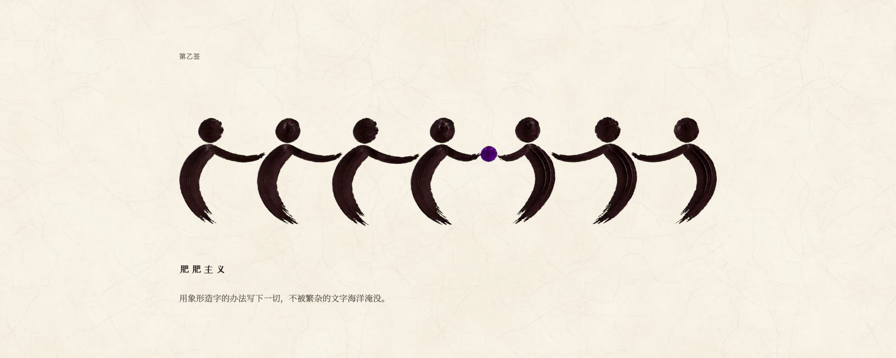
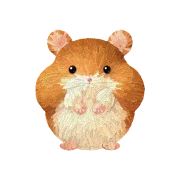

[中文](README.md) | **English**

> Knowledge, facts and discoveries are easily carried off. These things lie outside the person; style is the person.
>
> — Buffon, address to the Académie française, 1753

# Feifei-ism



In the lower right corner of a sheet of paper, there is a small seal.

It is small, and it tells you at a glance whose paper this is. These days the writing is often done by an agent. It builds the page, it draws the picture, and it makes more in a day than I can look at in a month. There is more and more of it, and less and less of it is ours. It looks like working with an agent, but the work is already steeped in the taste of AI: the most average thing possible, neither beautiful nor ugly, so ordinary that anyone's seal would do.

So I wrote my own style down, as something with thought, understanding and taste in it, and I am giving it away, so that anyone native to AI can use it to get that taste out.

In this society, whether you run a small shop, lead a team, write papers or are still at school, once there is an agent beside you, the two of you are one working whole, one productive whole, and no longer just one person. And if you are one whole, what you make should share one complete, unified aesthetic.

This has to start somewhere. It starts with Feifei-ism.

## What it looks like

In one sentence: write everything down in invented pictographs, and do not drown in the sea of words.

A person is one round dot and one curved stroke, with no legs and no face. A thing is one to three strokes, or a void scraped out of a slab of thick paint. Each work has one main colour plus ink, on faintly yellowed xuan paper. Where words can be left out, they are: a chain, and you roughly know it is about constraint; three circles growing in size, and you roughly know it is about three tiers.

Open the [showcase](https://chaorookie.github.io/feifei-ism/). You can tap the twelve lots to change the colour and press the buttons.

## Take it

This is written for agents. A skill is a bundle of instructions and tools that an agent follows.

```bash
git clone https://github.com/chaoRookie/feifei-ism.git
```

```bash
cp -R feifei-ism/feifei-ism ~/.claude/skills/
```

Then tell your agent:

```text
Make me a page in Feifei-ism.
```

| In the package | What it does |
|---|---|
| `references/DESIGN.md` | The design constitution, in Chinese: invented characters, colour, type, controls, motion, prompts for image models, and a checklist for delivery |
| `templates/` | Page template, paint buttons, long-page navigation |
| `assets/` | Palette-knife strokes, sample characters, xuan paper, dabs of paint |
| `scripts/` | Page assembly, cut-out, recolouring, paper making |

To make it yours, change three things. Draw one main colour from the twelve lots. Sign with your own name. Replace the companions in the navigation with your own.

For explanatory pages, use [jiepou](https://github.com/chaoRookie/jiepou), which also has a skill for explaining papers.

Buffon said style cannot be carried off. What you can carry off in this package is the way of writing.

When you finish, press the seal into the lower right corner.

## License

[MIT](LICENSE). Xiaofei is excluded (see [NOTICE](NOTICE)): `feifei-ism/assets/nav/xiaofei.js` and `assets/xiaofei.webp` are the author's own likeness, all rights reserved. It is sealed in one file, to be used whole and shown unchanged in the navigation. It may not be taken apart, modified, used on its own or sold. If you do not want it, delete the line in `templates/nav.html` that references it, and the navigation still works.

Fonts on the pages come from Google Fonts, each under its own license.
