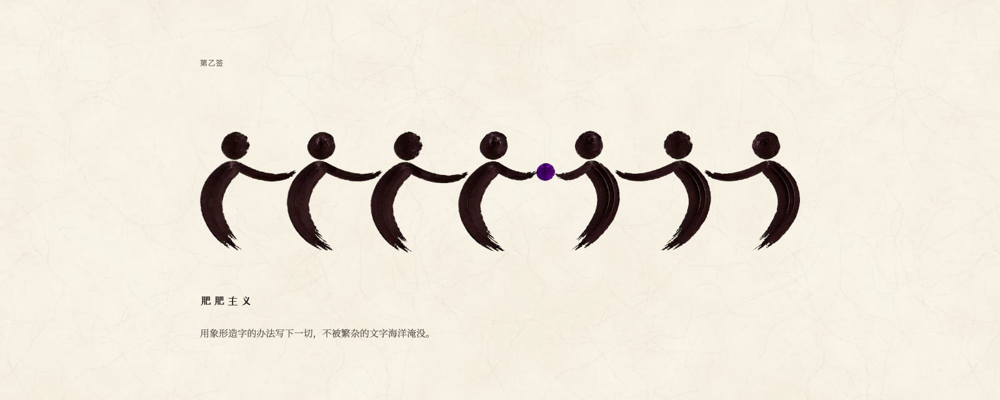
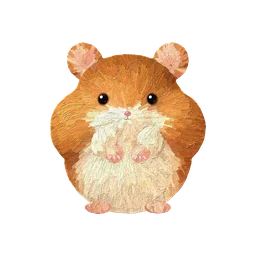

**中文** | [English](README.en.md)

> 知识、事实和发现，都容易被人拿走。这些东西在人的身外，风格却是那个人本身。
>
> ——布封，1753 年入法兰西学院时的演说

# 肥肥主义



一张纸的右下角，压着一方小印。

印很小，可一眼就知道这张纸是谁的。如今写字的常常是 agent，页面它搭，图它画，一天出的东西比我一个月看的还多。东西多了，却不是自己的了。看似在和 agent 协作，其实已被 AI 味笼罩：最平均的作品，谈不上好看，也谈不上丑，平庸得盖上谁的印都说得过去。

于是我把自己的风格总结下来，成了一套有思考、有理解、有审美的东西，并把它开源出来，让所有 AI native 的人都能借这个项目去掉 AI 味。

这个社会上，开小店的，带团队的，写论文的，还在上学的，不管是谁，只要身边有了 agent，你和它就是一个协作的整体，一个生产力的整体，不再只是一个人。既然是一个整体，做出来的东西就该有一套完整、统一的美学。

这件事总要有个开始。开始就是肥肥主义。

## 它长什么样

一句话：用象形造字的办法写下一切，不被繁杂的文字海洋淹没。

人是一个圆点加一笔弧线，不画腿，不画脸。物是一到三笔，或者一块厚颜料里刮出的空白。每件作品只有一个主色加墨，铺在微微泛黄的宣纸上。能不用字，就不用字：一条锁链，人就知道大概在讲约束；三个由小到大的圆，人就知道大概是三档。

打开[展示页](https://chaorookie.github.io/feifei-ism/)，十二支签可以点着换色，按钮可以按一按。

## 拿去用

这套东西写给 agent。技能（skill）是一包说明和工具，agent 照着它办事。

```bash
git clone https://github.com/chaoRookie/feifei-ism.git
```

```bash
cp -R feifei-ism/feifei-ism ~/.claude/skills/
```

然后对 agent 说一句：

```text
用肥肥主义给我做一个页面。
```

| 包里的东西 | 做什么 |
|---|---|
| `references/DESIGN.md` | 设计宪法：造字、配色、字体、控件、动效，以及给图像模型的提示词和交付前的自查清单 |
| `templates/` | 页面模板、颜料按钮、长页导航 |
| `assets/` | 刮刀笔触、样板字、宣纸、颜料团 |
| `scripts/` | 拼页、抠底、换色、造纸 |

想让它变成你的，动三处就够。从十二支签里抽一支主色。落款写你的名字。导航里的伙伴换成你自己的。

讲解类的页面用 [jiepou](https://github.com/chaoRookie/jiepou)，那里还有论文讲解的技能。

布封说风格拿不走。这包东西能带走的，是写法。

写完了，在右下角压一下。

## 许可证

[MIT](LICENSE)。小肥不在其内（见 [NOTICE](NOTICE)）：`feifei-ism/assets/nav/xiaofei.js` 和 `assets/xiaofei.webp` 是作者本人的形象，保留所有权利。它封在一个文件里，要用就整只用，随导航原样展示；不可以拆开、修改、单独取用或拿去卖。不想要它，删掉 `templates/nav.html` 开头引用它的那一行，导航照常。

页面用到的字体来自 Google Fonts，各有各的许可证。
